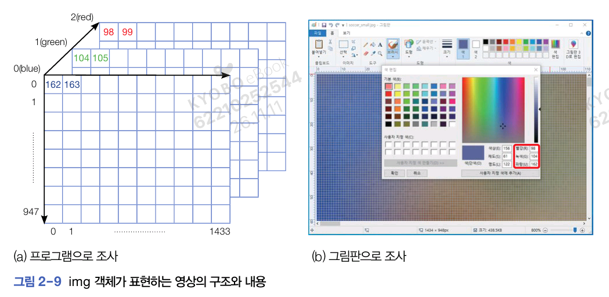
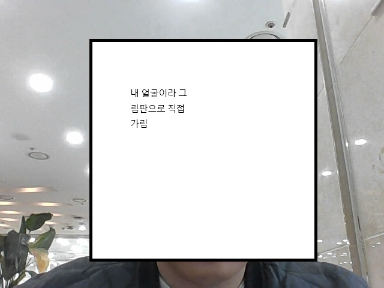
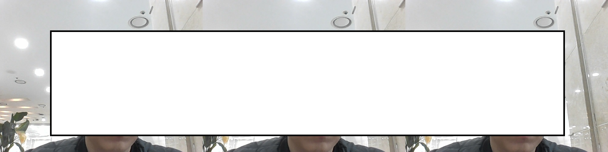
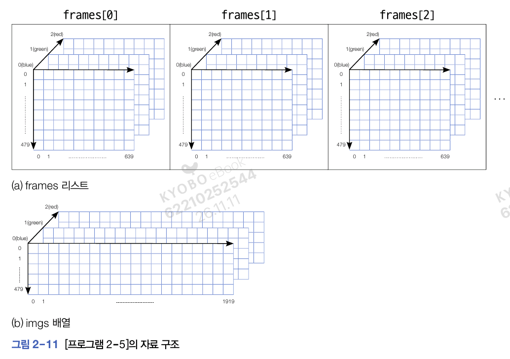

# 2. Opencv로 시작하는 컴퓨터비전
## 2.4. 영상을 읽고 표시하기

- imread(파일 경로): 이미지 파일 읽어오기
- imshow(창 이름, 이미지 변수): 이미지 보여주기 
- waitkey(): 키보드의 키다 눌릴 때까지 대기
    - 기본 매개변수 :0(무한정 기다림)
        - 매개변수로 정수를 주면 해당 초만큼 기다림
- destroyAllWindows(): waitkey()가 끝나면 이미지 닫기

> - 참고: 현재 폴더 위치를 해당 프로젝트의 data 폴더로 설정해둠
```py
import cv2
import sys

img = cv2.imread('./soccer.jpg')

if img is None:
    sys.exit('Can\'t find a file.')

cv2.imshow('Image Display', img)

cv2.waitKey()
cv2.destroyAllWindows()
```


### OpenCV에서 영상은 numpy.ndarray 클래스 형의 객체
- opencv에서 이미지를 ndarray 클래스로 다룸
    - 위 예제에서 쓰인 영상은 948x1434x3 크기의 3차원 배열
    > - *OpenCV에서 색상 순서는 BGR임*

```py
import cv2
import sys

img = cv2.imread('./soccer.jpg')

print(type(img))
print(img.shape)
```
```
<class 'numpy.ndarray'>
(948, 1434, 3)
```


#### 영상 구성 요소
- 화소(pixel): 영상을 구성하는 한 점
    - $(r, c)$(r은 행 좌표, c는 열좌표) 형식으로 표현
- 점의 좌표를 쓸 때 $(y, x)$ 순으로 씀
- 화소는 0~255 사이의 값을 가짐
- 이미지 색상은 b, g, r 순
    - 아래 예제에서 0행 0열의 파란색, 녹색, 빨간색의 값은 각각 162, 104, 98임
```py
print(img[0, 0, 0], img[0, 0, 1], img[0, 0, 2])
```

```
162 104 98
```

## 2.5. 영상 형태 변환하고 크기 축소하기
- cvtColor(이미지 변수, 변환 방법): 변환 방법대로 이미지를 변환
    - BGR2GRAY: BGR 이미지를 회색조(GRAY) 이미지로 변환
- resize(이미지, dsize, fx, fy): 이미지 크기 변환
    - dsize=(0, 0): fx와 fy의 비율에 따라감
    - fx, fy: 이미지의 가로/세로 비율
- imwrite(경로, 이미지): 해당 경로에 이미지 저장
```py
import cv2
import sys
import os # 폴더 만들려고 임포트

img = cv2.imread('soccer.jpg')
if img is None: sys.exit('Can\'t find a file.')

# 회색조 변환
gray = cv2.cvtColor(img, cv2.COLOR_BGR2GRAY)
gray_small = cv2.resize(
    gray, dsize=(0, 0), fx=0.5, fy=0.5) # 반으로 축소

# 영상을 파일에 저장
if not os.path.exists('transformed/c2'):
    os.makedirs('transformed/c2')

cv2.imwrite('./transformed/c2/soccer_gray.jpg', gray)
cv2.imwrite('./transformed/c2/soccer_gray_small.jpg', gray_small)

# 이미지 출력
cv2.imshow('Color image', img)
cv2.imshow('Gray image', gray)
cv2.imshow('Gray image small', gray_small)

cv2.waitKey()
cv2.destroyAllWindows()
```


- 컬러 이미지를 회색조로 변환하는 방법
$$I=round(0.299\times R + 0.587 \times G + 0.144\times B)$$
- $gray[0][0] = round(98*162 + 0.578*104 + 0.144*162)=109$

## 2.6. 웹캠에서 비디오 읽기
- VideoCapture(웹캠 번호, 비디오 화면 여부): 웹캠과 연결 시도
    - 0: 웹캠 번호. 웹 캠이 아나면 0을 줌
    - cv2.CAP_DSHOW: 비디오가 화면에 바로 나타나게 함

- cap.read(): 호출한 순간 영상의 한 장, 즉 프레임을 획득하고 성공 여부와 함께 프레임 반환

```py
import cv2
import sys
import os

cap = cv2.VideoCapture(0, cv2.CAP_DSHOW)
if not cap.isOpened():
    sys.exit('failure to connect camera')

print(cap)
while True:
    ret, frame = cap.read() # 비디오를 구성하는 프레임 획득

    if not ret:
        print('Exit loop to fail get frame')
        break

    cv2.imshow('Videw display', frame)
    cv2.imwrite('./transformed/c2/frame.jpg', frame)
    key = cv2.waitKey(1)
    if key == ord('q'):
        break

cap.release() # 카메라와 연결 끊기
cv2.destroyAllWindows()
```


### 비디오에서 영상 수집하기

```py
import cv2 as cv
import numpy as np
import sys

cap = cv.VideoCapture(0, cv.CAP_DSHOW)
if not cap.isOpened(): sys.exit('failure to connect camera')

frames = []

# 이미지 수집
while True:
    # 비디오 읽기
    ret, frame = cap.read()
    if not ret:
        print('Exit loop because of failure to get frames')
        break

    cv.imshow('Video desplay', frame)

    # 이미지 수집 과정
    key = cv.waitKey(1) # 1ms동안 키보드입력 기다리기
    # c 입력하면 프레임 추가
    if key==ord('c'):
        frames.append(frame)
    # q 입력하면 루프 나감
    elif key==ord('q'):
        break

cap.release()
cv.destroyAllWindows()

# 읽어들인 이미지 합치기
if len(frames) > 0:
    imgs = frames[0]
    
    # 프레임 3개까지 합치기
    for i in range(1, min(3, len(frames))):
        imgs = np.hstack((imgs, frames[i]))

    cv.imshow('collected images', imgs)
    cv.imwrite('./transformed/c2/frames.jpg', imgs)
    cv.waitKey()
    cv.destroyAllWindows()
```


- 위 과정에서
    - 프레임 개수: 16개 (c를 얼마나 눌렀는지에 따라 달라질 수 있음)
    - 수집된 프레임 크기: (480, 640, 3)
    - 이미지의 타입: 넘파이 배열
```py
# 읽어들인 이미지 합치기
# 윗 과정은 이전과 동일
if len(frames) > 0:
    imgs = frames[0]
    
    # 프레임 3개까지 합치기
    for i in range(1, min(3, len(frames))):
        imgs = np.hstack((imgs, frames[i]))

    cv.imshow('collected images', imgs)
    #cv.imwrite('./transformed/c2/frames.jpg', imgs)

    print('수집된 프레임 리스트 개수:', len(frames))
    print('프레임 크기:',frames[0].shape)
    print('이미지의 타입:', type(imgs))
    cv.waitKey()
    cv.destroyAllWindows()
```
```
수집된 프레임 리스트 개수: 16
프레임 크기: (480, 640, 3)
이미지의 타입: <class 'numpy.ndarray'>
```
- 이 과정에서 이미지는 3개까지 합침
    - -> 총 이미지(imgs)는 (480, 1920, 3) 크기의 넘파이 배열


### 마우스를 통한 상호작용
