# 3. 영상 처리
# 3.1. 디지털 영상 기초
## 영상 획득과 표현
### 핀홀 카메라와 디지털 카메라
#### 핀홀 카메라
- 물체에서 반사된 빛이 카메라의 작은 구멍을 통해 안으로 들어가 뒷면에 있는 영상 평면에 맺힘
- 영상 평면은 눈의 경우 망막, 디지털카메라의 경우 CCD 센서


#### 디지털 카메라에 저장
- 빛을 받은 CCD 센서는 디지털로 변환한 영상을 샘플링과 양자화 후 메모리에 저장
- 샘플링: 2차원 영상 공간을 MxN 크기의 영상으로 변환
    - 크기(또는 해상도): 영상 크기인 MxN


### 영상 좌표계: (y,x)와 (x, y) 표기


- OpenCV의 영상 표현: ndarray
    - numpy가 사용하는 다양한 함수 사용 가능
- 영상 저장하는 배열에서 화소를 저장할 때 (y, x) 표기를 사용
- 예시
```py
# 10, 20에서 시작해 100, 20에서 끝나는 선
cv.line(img, (10, 20), (100, 20))
```

## 3.1.2. 다양한 종류의 영상
- 명암(grayscale) 영상: 2차원 구조 배열로 표현
- RGB(Red Green Blue) 영상: 3개 채널로 구성된 컬러 영상
- 다분광(multispectral)/초분광(hyperspectral) 영상: 3개 이상의 채널을 가진 영상
    - 다분광은 최대 10개, 초분광은 그 이상(수백개~수천개 정도)


## 3.1.3. 컬러 모델
#### 삼원색 - RGB 컬러
- Red: (1, 0, 0)
- Green: (0, 1, 0)
- Blue: (0, 0, 1)
    - 범위가 [0, 1]일 때 기준

- 실제로는 256으로 양자화
    - Red: (255, 0, 0)
    - Green: (0, 255, 0)
    - Blue: (0, 0, 255)


#### HSV
- H: 색상
    - R, G, B 값이 모두 섞임 -> 빛이 약해지면 셋 다 약해짐
- S: 채도
- V: 명암

### RGB 채널별로 디스플레이
```py
import cv2 as cv

img = cv.imread('./soccer.jpg')
root = './transformed/c3'

# 원본
cv.imshow(f'Original(size: {img.shape})', img)
cv.imwrite('./transformed/c3/Original.jpg', img)


# 왼쪽 상단 부분
img_ULH = img[0:img.shape[0]//2, 0:img.shape[1]//2, :]
cv.imshow('Upper left half', img_ULH)
cv.imwrite('./transformed/c3/Upper_left_half.jpg', img_ULH)


# 중앙
img_CH =  img[img.shape[0]//4:3 * img.shape[0]//4,
               img.shape[1]//4:3 * img.shape[1]//4]
cv.imshow('Central half', img_CH)
cv.imwrite('./transformed/c3/Central_Half.jpg', img_CH)


# R 채널
img_R = img[:, :, 2]
cv.imshow('R channel', img_R)
cv.imwrite(f'{root}/img_R.jpg', img_R)


# G 채널
img_G = img[:, :, 1]
cv.imshow('G channel', img_G)
cv.imwrite(f'{root}/img_G.jpg', img_G)

# B 채널
img_B = img[:, :, 0]
cv.imshow('B channel', img_B)
cv.imwrite(f'{root}/img_B.jpg', img_G)

cv.waitKey()
cv.destroyAllWindows()
```


---
# 3.2. 이진 영상
- 이진 영상(binary image): 화소가 0(흑) 또는 1(백)인 영상
## 3.2.1. 이진화
$$b(j, i) = \left\{\begin{matrix}
1,\ f(j, i)\geq T\\
0,\ f(j, i)< T
\end{matrix}\right.$$
- 임계값 T가 너무 낮게 또는 너무 높게 설정되면 대부분 화소가 배경에 쏠림

### 예시 3.1. 히스토그램을 이용한 이진화
- 히스토그램: 0, 1, ..., L-1의 명암 단계 각각에 대해 화소의 발생 빈도를 나타낸 일차원 배열
- 임계값 T=4로 지정
    - 입력 영상에서 빈도가 4 이상이면 1, 그렇지 않으면 0


#### 간단한 히스토그램
- calchist(영상, 영상의 채널, 구할 영역, 명암 단계, 명암값 범위)
    - 인수는 리스트로 줘야 함
    - 구할 영역=None: 모든 영역에서 히스토그램 계산
    - 명암 단계 L=256: 히스토그램 칸의 수는 256개
    - 명암 범위 [0, 256]: 256 이상인 값은 세지 않음
```py
import cv2 as cv
import matplotlib.pyplot as plt

img = cv.imread('./soccer.jpg')

# R 채널에서 히스토그램 구하기
h = cv.calcHist([img], [2], None, [256], [0, 256])
plt.plot(h, color='r', linewidth=1)
plt.show()

```


## 3.2.2. 오츄 알고리즘
- 오츄 알고리즘: 모든 명앙값에 대해 목적 함수 J를 계산하고 J가 최소인 명암값을 최적값 $\hat{i}$ 로 정함
$$\hat{i}=\argmin_{i\in\{0, 1, 2, ..., L-1\}} J(t)$$
- 목적함수 $J(t)$: t의 좋은 정도를 측정
- 오츄는 t로 이진화했을 때 0이 되는 화소의 분산과 1이 되는 화소의 분산의 가중치 합을 J로 사용
$$J(t)=n_0(t)v_0(t)+n_1(t)v_1(t)$$

### 이진화
- THRESH_BINARY + THRESH_OTSU: 오츄  알고리즘을 이진화 수행
```py
import cv2 as cv

img = cv.imread('./soccer.jpg')

# img의 R 채널을 이진화 수행
t, bin_img = cv.threshold(
    img[:, :, 2], 0, 255,
    cv.THRESH_BINARY + cv.THRESH_OTSU)
print(f'Best threshold that finded by Otsu algorithm: {t}')

cv.imshow('R channel', img[:,:, 2])
cv.imshow('R channel binarization', bin_img)

cv.imwrite('./transformed/c3/R_chn.jpg', img[:, :, 2])
cv.imwrite('./transformed/c3/R_chn_bin.jpg', bin_img)

cv.waitKey()
cv.destroyAllWindows()
```


### 최적화 문제
- 오츄 알고리즘에서 매개변수 t: 해 공간
    - $L=256$ 일 때, 해 공간 $\{0, 1, 2, ..., 255\}$
- 오츄 알고리즘은 모든 후보에 대해 목적함수를 계산하고 최소가 되는 t를 최적해로 결정

## 3.2.3. 연결 요소
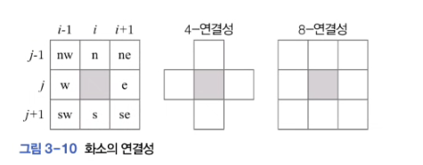
- 연결 요소(connected component): 1의 값을 가진 연결된 화소의 집합

## 3.2.4. 모폴로지
- 모폴로지(mopology): 구조 요소를 이용해 영역의 모양을 조작
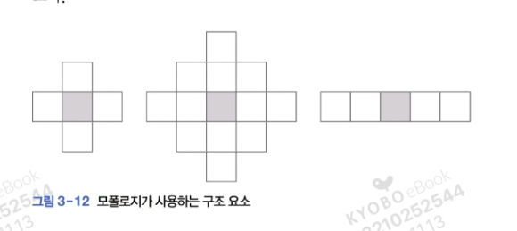

### 팽창, 침식, 열림, 닫힘
- 팽창: 구조 요소의 중심을 1인 화소에 씌운 다음 구조 요소에 해당하는 모든 화소를 1로 바꿈
- 침식: 영역의 경계에 솟은 돌출 부분을 깎음

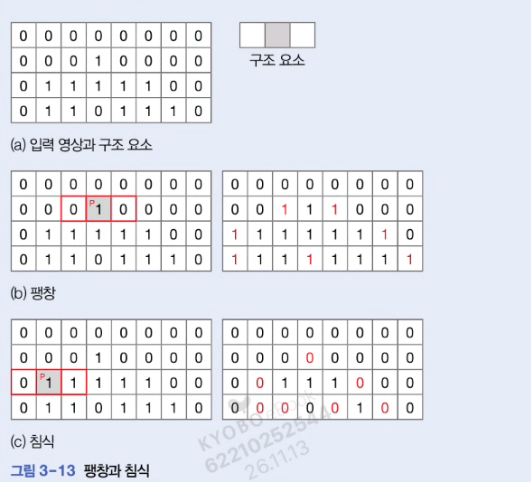

### 모폴로지 연산

```py
import cv2 as cv
import numpy as np
import matplotlib.pyplot as plt

# 4개의 채널을 가진 영상
# IMREAD_UNCHANGED로 모든 채널 읽어오기
img = cv.imread(
    './JohnHancocksSignature.png',
    cv.IMREAD_UNCHANGED)

# 구조 요소
se = np.uint8([
    [0, 0, 1, 0, 1],
    [0, 1, 1, 1, 0],
    [1, 1, 1, 1, 1],
    [0, 1, 1, 1, 0],
    [0, 0, 1, 0, 0]
])


# 오츄 이진화
t, bin_img = cv.threshold(
    img[:, :, 3], 0, 255,
    cv.THRESH_BINARY + cv.THRESH_OTSU)

plt.imshow(bin_img, cmap='gray')
plt.xticks([]); plt.yticks([])
plt.savefig('./transformed/c3/otsu_bin.png')
plt.show()


# 모폴로지 확인용으로 영상 자르기
b = bin_img[
    bin_img.shape[0]//2:bin_img.shape[0],
    0:bin_img.shape[0]//2+1
]
plt.imshow(b, cmap='gray')
plt.xticks([]); plt.yticks([])
plt.savefig('./transformed/c3/cutted.png')
plt.show()


# 팽창
b_dilation = cv.dilate(b, se, iterations=1)
plt.imshow(b_dilation, cmap='gray')
plt.xticks([]); plt.yticks([])
plt.savefig('./transformed/c3/delation.png')
plt.show()


# 침식
b_erosion = cv.erode(b, se, iterations=1)
plt.imshow(b_dilation,  cmap='gray')
plt.xticks([]); plt.yticks([])
plt.savefig('./transformed/c3/erosion.png')
plt.show()


# 닫힘
b_closing = cv.erode(cv.dilate(b, se, iterations=1), se, iterations=1)
plt.imshow(b_dilation, cmap='gray')
plt.xticks([]); plt.yticks([])
plt.savefig('./transformed/c3/closed.png')
plt.show()
```

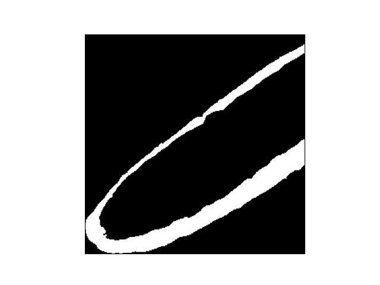
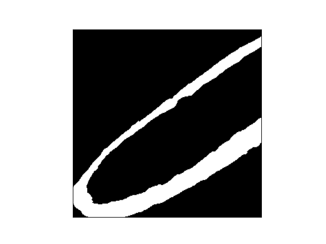


---
# 3.3. 점 연산

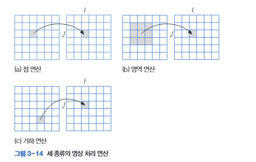

- 화소 입장에서 영상처리: 화소가 새로운 값을 받는 과정

## 3.3.1. 명암 조절
$$f'(i, j)=\left\{\begin{matrix}
\min(f(j, i) + a,\ L-1)\ 밝게\\
\max(f(j, i)-a,\ 0)\ 어둡게\\
(L-1)-f(j, i)\ 반전
\end{matrix}\right.
$$

```py
import cv2 as cv
import numpy as np

img = cv.imread('soccer.jpg')
img = cv.resize(img, dsize=(0, 5), fx=0.25, fy=0.25) # 1/4 크기로

def gamma(f, gamma=1.0):
    f1 = f / 255.0
    return np.uint8(255 * (f1**gamma))

gc = np.hstack((
    img,
    gamma(img, 0.5),
    gamma(img, 0.75),
    gamma(img, 1.0),
    gamma(img, 2.0),
    gamma(img, 3.0)
))

cv.imshow('gamma', gc)
cv.imwrite('./transformed/c3/gammas.jpg', gc)
cv.waitKey()
cv.destroyAllWindows()
```


## 3.2.2. 히스토그램 평활화
- 히스토그램 평활화: 히스토그램이 평형하게 되도록 영상을 조작해 영상의 명암대비 높이는 기법
$$l' = round(j_i(l) \times (L-1))$$

#### 히스토그램 평활화 예시
```
def z(h):
    return (z-mu(h)) / sigma(h)

l = range(8)
h = [2, 12, 17, 10, 3, 7, 11, 2]
h_prime = z(h)
h7 = h_prime * 7
l_prime = round(h7)
```

```py
import cv2 as cv
import matplotlib.pyplot as plt

img = cv.imread('./mistyroad.jpg')

# 이미지 명암으로 변경
gray = cv.cvtColor(img, cv.COLOR_BGR2GRAY)
plt.imshow(gray, cmap='gray')
plt.xticks([]); plt.yticks([]); plt.savefig('./transformed/c3/gray_img.jpg')
plt.show()


# 히스토그램 구해서 출력
h = cv.calcHist(
    [gray], [0], None, [256], [0, 256]
)
plt.plot(h, color='r', linewidth=1)
plt.savefig('./transformed/c3/hist_graph.jpg')
plt.show()


# 평활화 적용한 이미지
equal = cv.equalizeHist(gray)
plt.imshow(equal, cmap='gray')
plt.xticks([]); plt.yticks([])
plt.savefig('./transformed/c3/flattened_hist.jpg')
plt.show()


# 평활화 적용한 이미지의 히스토그램
h = cv.calcHist(
    [equal], [0], None, [256], [0, 256]
)
plt.plot(h, color='r', linewidth=1)
plt.savefig('./transformed/c3/flattened_hist_graph.jpg')
plt.show()

```
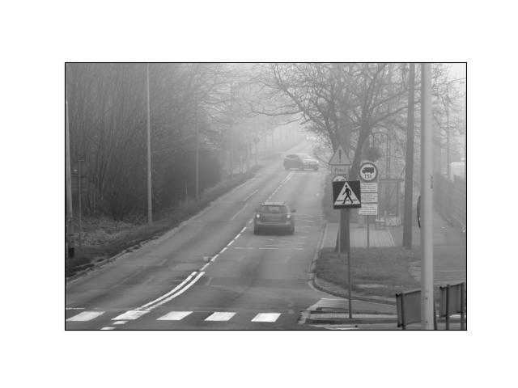

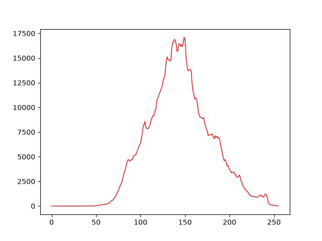

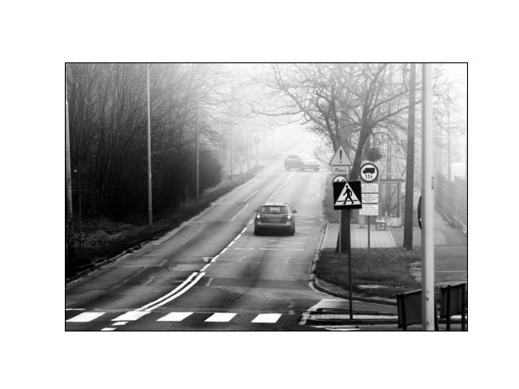

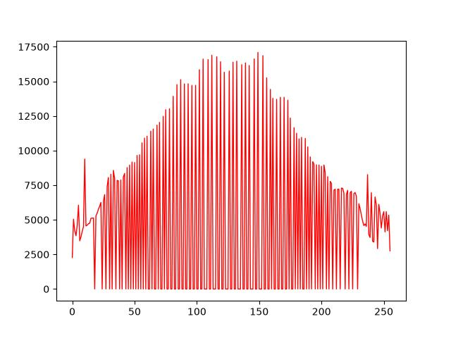

---

# 3.4. 영역 연산
## 3.4.1. 컨볼루션
- 입력 영상 f의 각 화소에 필터를 적용해 곱의 합을 구하는 연산
$$f'(x)=\sum_{i=-(w-1)/2}^{(w-1)/2}u(i)f(x+i)$$

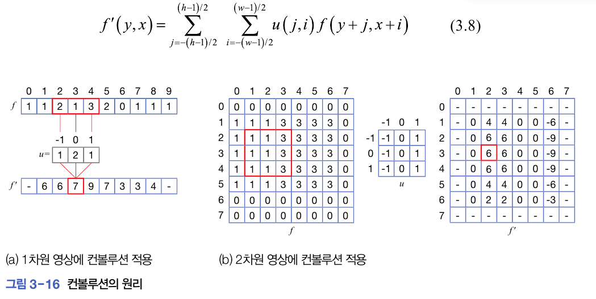
#### 예제 a
- 1차원 영상에 컨볼루션
- 필터: $u=\begin{pmatrix}
-1&0&1
\end{pmatrix}$

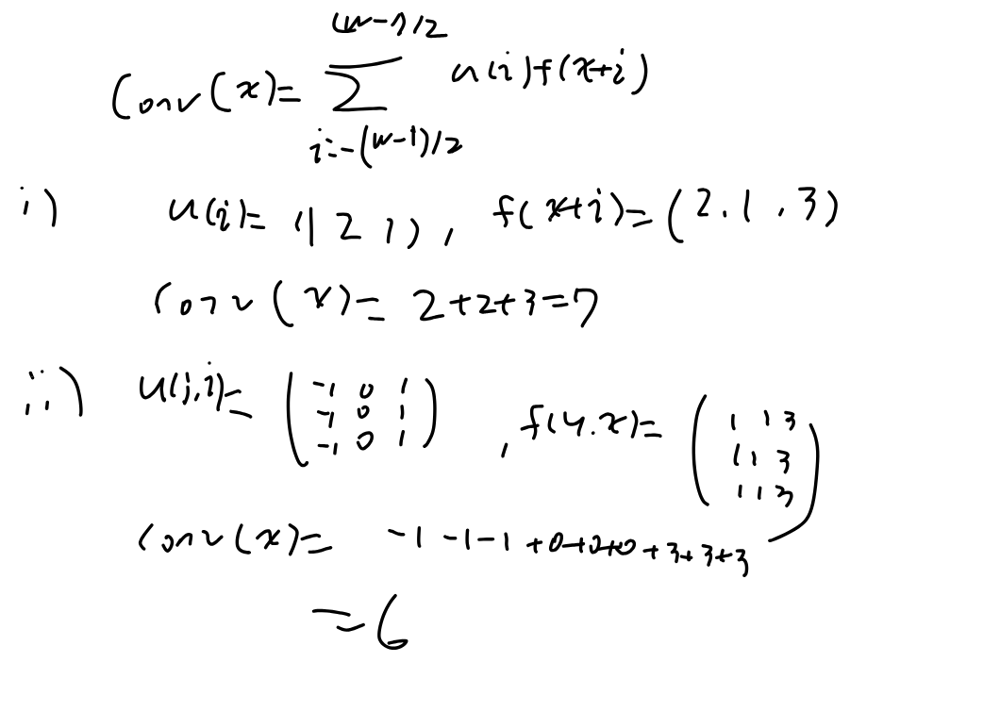

## 3.4.2. 다양한 필터
#### 스무딩 필터
- 잡음 누그러뜨리기
- 가우시안 함수 사용
$$g(y, x)=\frac{1}{\sigma\sqrt{w\pi}}e^{-\frac{y^2+x^2}{2\sigma^2}}$$

#### 샤프닝 필터
- 엣지를 선명하게 해서 물체 식별 도움
- 스무딩 필터와 반대
#### 엠보싱 필터
- 물체에 돋움새김

## 3.4.3. 데이터 형과 컨볼루션
- 가우시안 블러링: GaussianBlur(이미지, 컨볼루션 필터 크기, 표준 편차)
    - 표준편차를 0.0으로 설정하면 필터 크기 보고 자동으로 추정

- 엠보싱: filter2D(이미지, -1, 필터)
```py
import cv2 as cv
import numpy as np


root = './transformed/c3/'

img = cv.imread('./soccer.jpg')
img = cv.resize(img, dsize=(0, 0),
                fx=0.4, fy=0.4)

gray = cv.cvtColor(img, cv.COLOR_BGR2GRAY)
cv.putText(
    gray, 'soccer', (10, 20), cv.FONT_HERSHEY_COMPLEX,
    0.7, (255, 255, 255), 2
)
cv.imshow('Original', gray)
cv.imwrite('./transformed/c3/before_conv.jpg', gray)


# 가우시안 스무딩
smooth = np.hstack((
    cv.GaussianBlur(gray, (5, 5), 0.0),
    cv.GaussianBlur(gray, (9, 9), 0.0),
    cv.GaussianBlur(gray, (15, 15), 0.0)
))
cv.imshow('Smooth', smooth)
cv.imwrite('./transformed/c3/smoothed.jpg', smooth)


# 엠보싱
femboss = np.array([
    [-1., 0., 0.],
    [0., 0., 0.],
    [0., 0., 1.]
])

gray16 = np.int16(gray)
emboss = np.uint8(
    np.clip(cv.filter2D(gray16, -1, femboss)+128, 0, 255)
)
emboss_bad = np.uint8(
    cv.filter2D(gray16, -1, femboss)+128
)
emboss_worse = cv.filter2D(gray, -1, femboss)

cv.imshow('Emboss', emboss); cv.imwrite(root+'/Emboss.jpg', emboss)
cv.imshow('Emboss bad', emboss_bad); cv.imwrite(root+'Emboss_bad.jpg', emboss_bad)
cv.imshow('Emboss worse', emboss_worse); cv.imwrite(root+'Emboss_worse.jpg', emboss_worse)

cv.waitKey()
cv.destroyAllWindows()
```


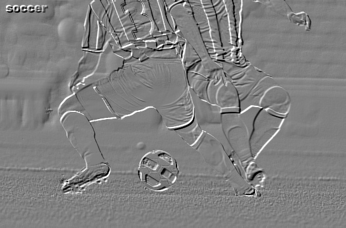
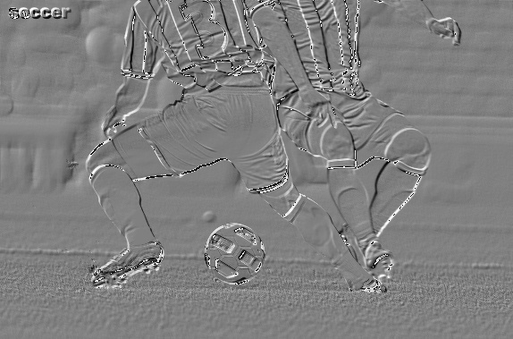
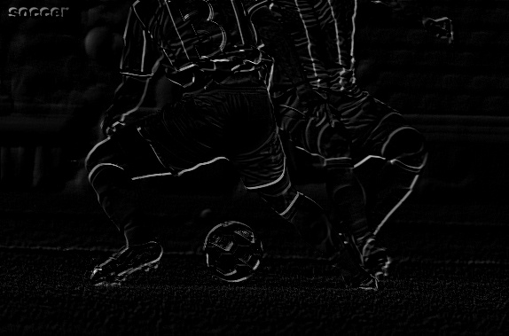

---
# 3.5. 기하 연산
## 3.5.1. 동차 좌표와 동차 행렬
- 동차 좌표: 2차원 점 (x, y)에 1을 추가해 3차원 벡터로 표현
$$\bar{p}=(x, y, 1)$$
#### 3x3 동차 변환
- 이동: x 방향으로 $t_x,\ y$ 방향으로 $t_y$만큼 이동
$$T(t_x, t_y)=\begin{bmatrix}1&0&_x\\
0&1&t_y\\
0&0&1\end{bmatrix}$$
- 회전: 원점을 중심으로 반시계 방향으로 $\theta$만큼 회전
$$R(\theta)=\begin{bmatrix}
cos(\theta)&sin(\theta)&0\\
-sin(\theta)&cos(\theta)&0\\
0&0&1
\end{bmatrix}$$
- 크기: x 방향으로 $s_x, y$ 방향으로 $s_y$만큼 크기 조정
$$S(s_x, s_y)=\begin{bmatrix}s_x&0&0\\
0&s_y&0\\
0&0&1\end{bmatrix}$$

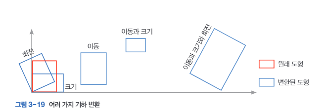

## 3.5.2. 영상의 기하 변환
- 영상을 그냥 회전하거나 크기를 조정하면 화소 위치에서 비는 곳이 있음
    - 에일리어싱
- 안티 에일리어싱: 에일리어싱 누그러뜨리는 방법
    - 원래 영상의 해당 화소를 찾는 후방 변환 사용
    - 전방 변환과정에서 A를 역행렬 $A^{-1}$ 사용

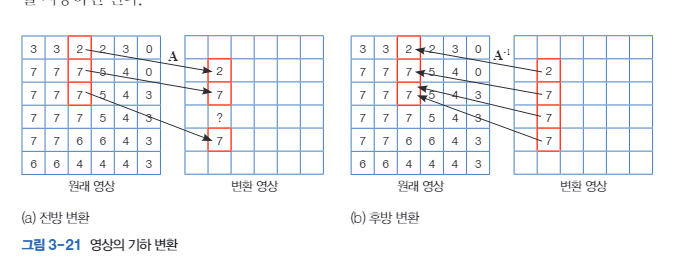

## 3.5.3. 영상 보간
- 후방 변환할 떄 실수 좌표를 정수로 변환하는 과정 필요
    - 최근접 이웃
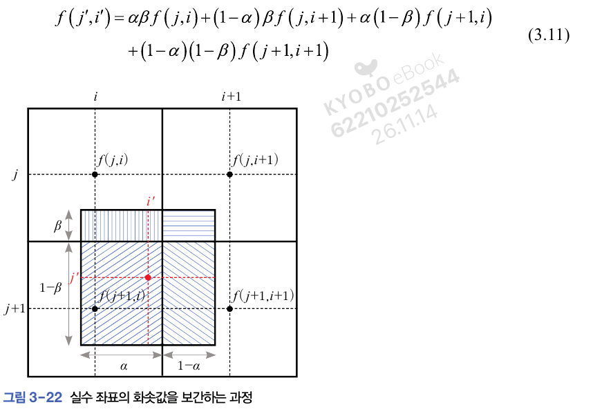

### 보간을 이용한 영상 변환
```py
import cv2 as cv
from make_folder import root

img = cv.imread('./rose.png')
print(img.shape)
patch = img[250:350, 170:270, :] # 100x100 패치 자르기
print(patch.shape)

# 패치에 최근접이웃 진행
# 파란색 사각형
img = cv.rectangle(img, (170, 250), (270, 350), (255, 0, 0), 3)
# 최근접 이웃 보간
patch1 = cv.resize(
    patch, dsize=(0, 0), fx=5, fy=5, interpolation=cv.INTER_NEAREST
)
# 선형 보간
patch2 = cv.resize(
    patch, dsize=(0, 0), fx=5, fy=5, interpolation=cv.INTER_LINEAR
)
# 양3차 보간
patch3 = cv.resize(
    patch, dsize=(0, 0), fx=5, fy=5, interpolation=cv.INTER_CUBIC
)


cv.imshow('Origianl', img)
cv.imwrite(root + '/3_5_1_Original.png', img)

cv.imshow('Resize nearest', patch1)
cv.imwrite(root + '/3_5_1_nearest.png', patch1)

cv.imshow('Resize bilinear', patch2)
cv.imwrite(root+'/3_5_1_bilinear.png', patch2)

cv.imshow('Resize bicubic', patch3)
cv.imwrite(root+'/3_5_1_cubic.png', patch3)

cv.waitKey()
cv.destroyAllWindows()
```
- 순서대로 원본, nearest, bilinear, cubic
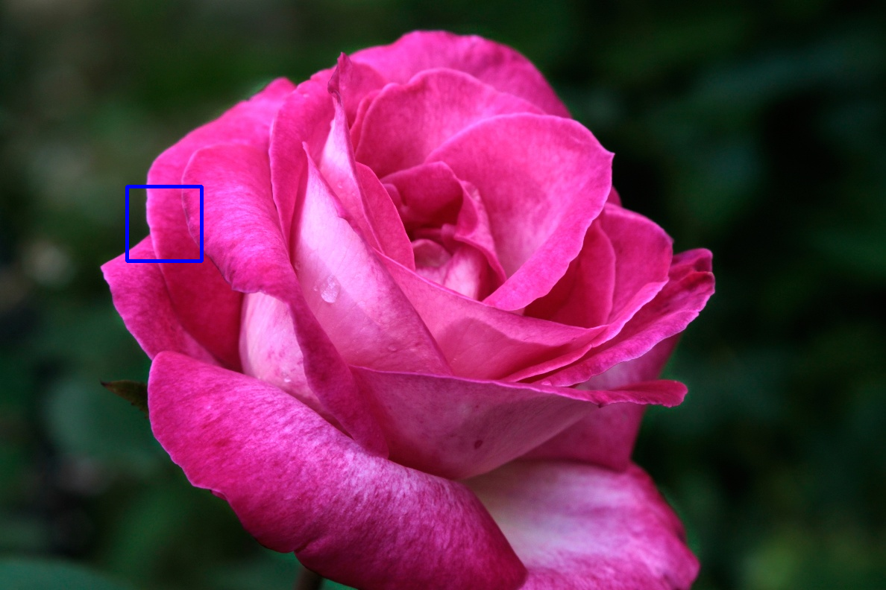


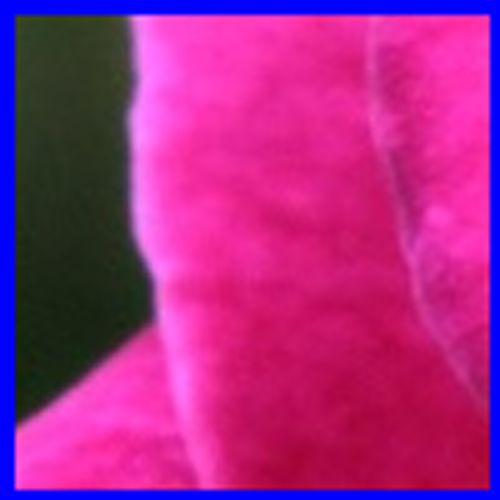