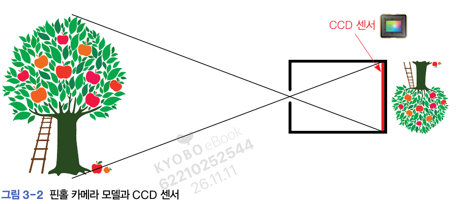
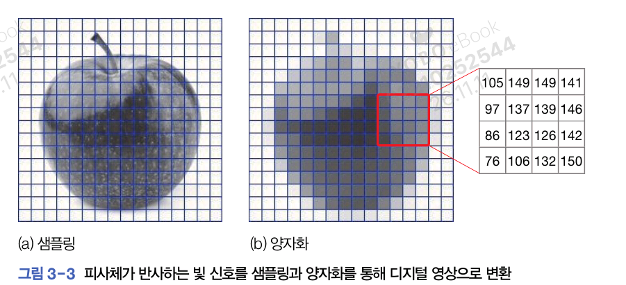
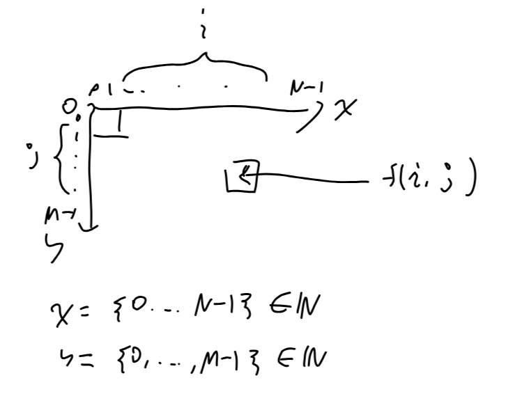
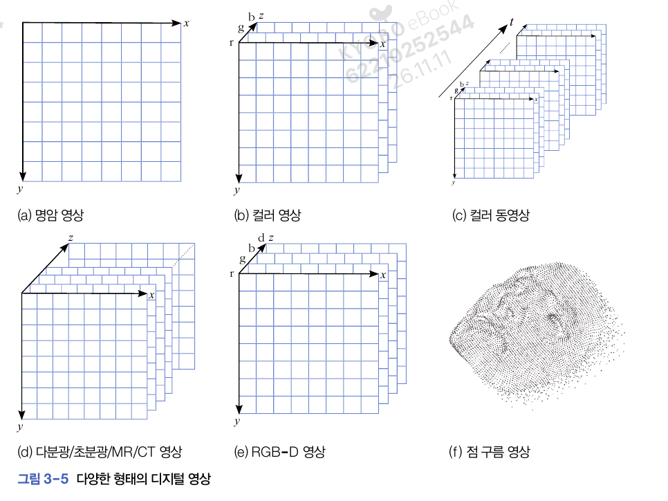
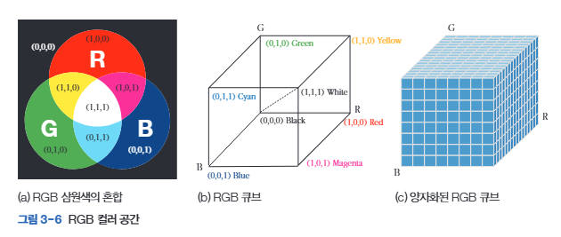
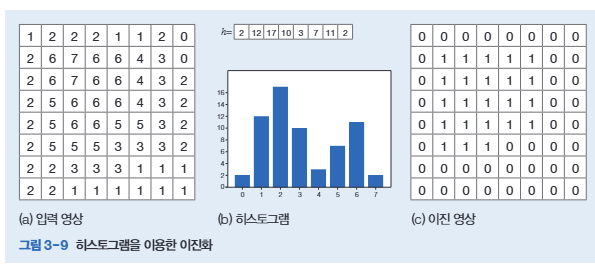
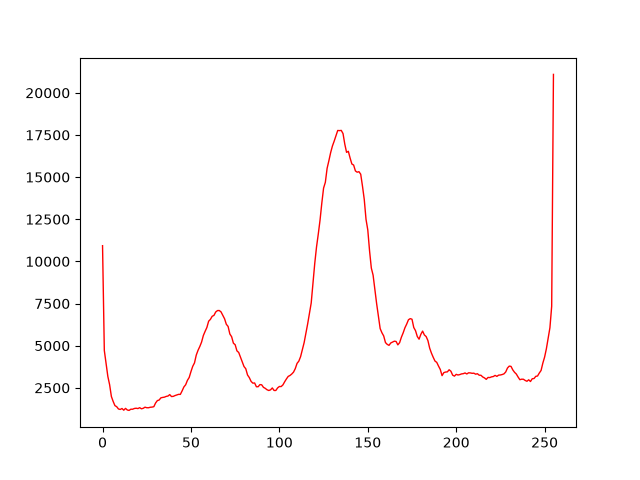

# 3. 영상 처리
# 3.1. 디지털 영상 기초
## 영상 획득과 표현
### 핀홀 카메라와 디지털 카메라
#### 핀홀 카메라
- 물체에서 반사된 빛이 카메라의 작은 구멍을 통해 안으로 들어가 뒷면에 있는 영상 평면에 맺힘
- 영상 평면은 눈의 경우 망막, 디지털카메라의 경우 CCD 센서


#### 디지털 카메라에 저장
- 빛을 받은 CCD 센서는 디지털로 변환한 영상을 샘플링과 양자화 후 메모리에 저장
- 샘플링: 2차원 영상 공간을 MxN 크기의 영상으로 변환
    - 크기(또는 해상도): 영상 크기인 MxN


### 영상 좌표계: (y,x)와 (x, y) 표기


- OpenCV의 영상 표현: ndarray
    - numpy가 사용하는 다양한 함수 사용 가능
- 영상 저장하는 배열에서 화소를 저장할 때 (y, x) 표기를 사용
- 예시
```py
# 10, 20에서 시작해 100, 20에서 끝나는 선
cv.line(img, (10, 20), (100, 20))
```

## 3.1.2. 다양한 종류의 영상
- 명암(grayscale) 영상: 2차원 구조 배열로 표현
- RGB(Red Green Blue) 영상: 3개 채널로 구성된 컬러 영상
- 다분광(multispectral)/초분광(hyperspectral) 영상: 3개 이상의 채널을 가진 영상
    - 다분광은 최대 10개, 초분광은 그 이상(수백개~수천개 정도)


## 3.1.3. 컬러 모델
#### 삼원색 - RGB 컬러
- Red: (1, 0, 0)
- Green: (0, 1, 0)
- Blue: (0, 0, 1)
    - 범위가 [0, 1]일 때 기준

- 실제로는 256으로 양자화
    - Red: (255, 0, 0)
    - Green: (0, 255, 0)
    - Blue: (0, 0, 255)



#### HSV
- H: 색상
    - R, G, B 값이 모두 섞임 -> 빛이 약해지면 셋 다 약해짐
- S: 채도
- V: 명암

### RGB 채널별로 디스플레이
```py
import cv2 as cv

img = cv.imread('./soccer.jpg')
root = './transformed/c3'

# 원본
cv.imshow(f'Original(size: {img.shape})', img)
cv.imwrite('./transformed/c3/Original.jpg', img)


# 왼쪽 상단 부분
img_ULH = img[0:img.shape[0]//2, 0:img.shape[1]//2, :]
cv.imshow('Upper left half', img_ULH)
cv.imwrite('./transformed/c3/Upper_left_half.jpg', img_ULH)


# 중앙
img_CH =  img[img.shape[0]//4:3 * img.shape[0]//4,
               img.shape[1]//4:3 * img.shape[1]//4]
cv.imshow('Central half', img_CH)
cv.imwrite('./transformed/c3/Central_Half.jpg', img_CH)


# R 채널
img_R = img[:, :, 2]
cv.imshow('R channel', img_R)
cv.imwrite(f'{root}/img_R.jpg', img_R)


# G 채널
img_G = img[:, :, 1]
cv.imshow('G channel', img_G)
cv.imwrite(f'{root}/img_G.jpg', img_G)

# B 채널
img_B = img[:, :, 0]
cv.imshow('B channel', img_B)
cv.imwrite(f'{root}/img_B.jpg', img_G)

cv.waitKey()
cv.destroyAllWindows()
```


# 3.2. 이진 영상
- 이진 영상(binary image): 화소가 0(흑) 또는 1(백)인 영상
## 3.2.1. 이진화
$$b(j, i) = \left\{\begin{matrix}
1,\ f(j, i)\geq T\\
0,\ f(j, i)< T
\end{matrix}\right.$$
- 임계값 T가 너무 낮게 또는 너무 높게 설정되면 대부분 화소가 배경에 쏠림

### 예시 3.1. 히스토그램을 이용한 이진화
- 히스토그램: 0, 1, ..., L-1의 명암 단계 각각에 대해 화소의 발생 빈도를 나타낸 일차원 배열
- 임계값 T=4로 지정
    - 입력 영상에서 빈도가 4 이상이면 1, 그렇지 않으면 0



#### 간단한 히스토그램
- calchist(영상, 영상의 채널, 구할 영역, 명암 단계, 명암값 범위)
    - 인수는 리스트로 줘야 함
    - 구할 영역=None: 모든 영역에서 히스토그램 계산
    - 명암 단계 L=256: 히스토그램 칸의 수는 256개
    - 명암 범위 [0, 256]: 256 이상인 값은 세지 않음
```py
import cv2 as cv
import matplotlib.pyplot as plt

img = cv.imread('./soccer.jpg')

# R 채널에서 히스토그램 구하기
h = cv.calcHist([img], [2], None, [256], [0, 256])
plt.plot(h, color='r', linewidth=1)
plt.show()

```


## 3.2.2. 오츄 알고리즘
- 오츄 알고리즘: 모든 명앙값에 대해 목적 함수 J를 계산하고 J가 최소인 명암값을 최적값 $\hat{i}$ 로 정함
$$\hat{i}=\argmin_{i\in\{0, 1, 2, ..., L-1\}} J(t)$$
- 목적함수 $J(t)$: 