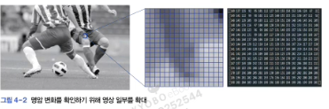
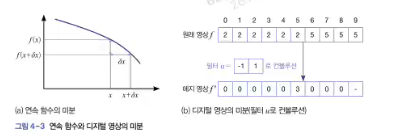
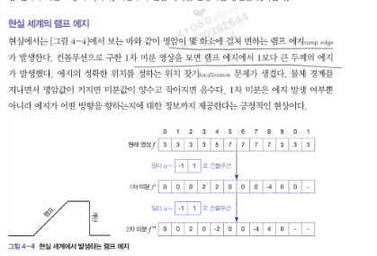
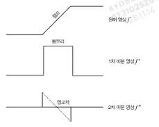
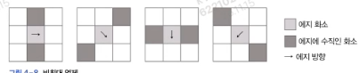
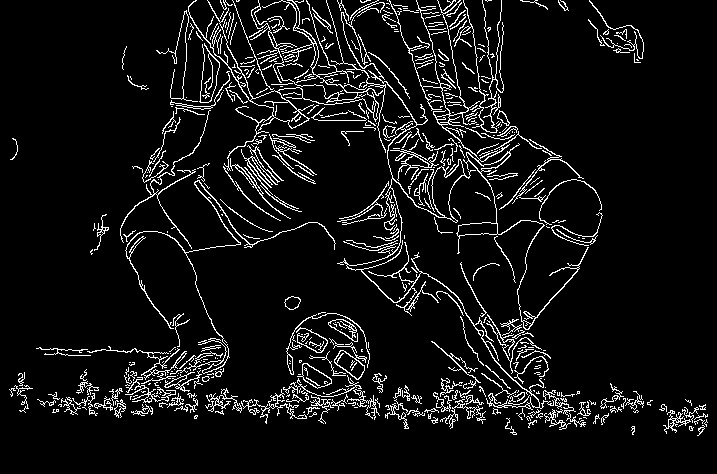
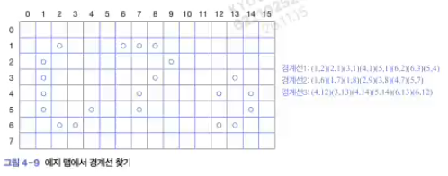
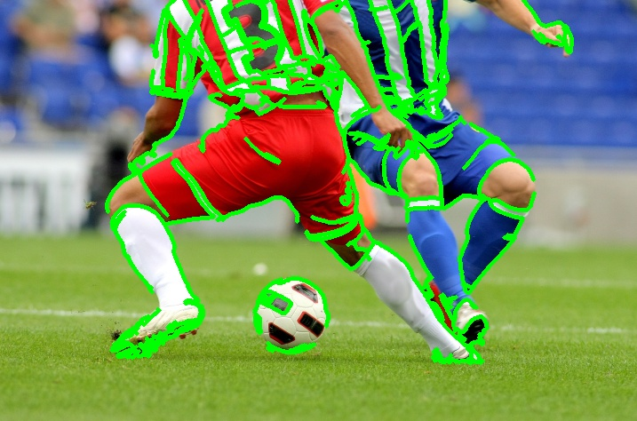
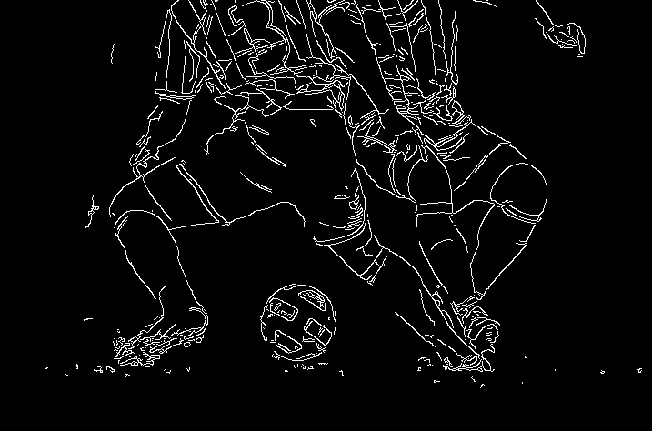

# 4. **에지와 영역**
# 4.1. 에지 검출
- 에지 검출 알고리즘: 물체 내부는 명암이 서서히 변하고 물체 경계는 명암이 급격히 변하는 특성 활용

## 4.1.1. 영상의 미분



## 4.1.2. 에지 연산자
### 현실 새계의 램프 에지

- 램프 에지: 명암이 몇 화소에 걸쳐 변하는 현상
    - 컨볼루션으로 구한 1차 미분 영상의 경우 램프 에지에서 1보다 큰 두께의 에지가 발생 -> 위치찾기 문제
- 2번 미분: 영교차 발생
    - 영교차: 왼쪽과 오른쪽 부호가 다른 반응이 나타나고 자신은 0을 갖는 위치




### 1차 미분에 기반한 연산자

- 필터를 3x3 크기로 확장하면 잡음 흡수하여 더 좋은 성능


- 에지 강도: 에지일 가능성을 나타내는 척도
- 에지 방향: 에지의 진행 방향

$$strength:\ s(y, x)=\sqrt{f'_x(y, x)^2 + f'_x(y, x)^2}\\
gredient\ direction:\ d(y, x)=atan(\frac{f'_y(y, x)}{f'_x(y, x)})$$


### 소벨 연산자의 적용
- cv.Sobel(적용할 이미지, 결과 영상 저장 방식, x방향, y방향, 커널 사이즈): 에지 방향 정하기
    - x방향: 1, y방향: 0 -> x방향으로 소벨 에지 검출
    - x방향: 0, y방향: 1 -> y방향으로 소벨 에지 검출

- cv.convertScaleAbs(소벨 방향): 소벨 연산 적용
- cv.addWeight(img1, a, img2, b, c): $img1 \times a + img2 \times b + c$ 계산

```py
import cv2 as cv
from make_folder import root

img = cv.imread('soccer.jpg')
gray = cv.cvtColor(img, cv.COLOR_BGR2GRAY)
x, y = gray.shape[:2]
x //= 2; y //= 2
gray = cv.resize(gray, (y, x))  # 이미지 크기 조정


# 소벨 연산자 적용
grad_x = cv.Sobel(gray, cv.CV_32F, 1, 0, ksize=3)
grad_y = cv.Sobel(gray, cv.CV_32F, 0, 1, ksize=3)


# 절대값을 취해 양수 영상으로 변환
sobel_x = cv.convertScaleAbs(grad_x)
sobel_y = cv.convertScaleAbs(grad_y)


# 에지 강도 계싼
edge_strength = cv.addWeighted(
    sobel_x, 0.5, sobel_y, 0.5, 0
)

cv.imshow('Original', gray)
cv.imshow('sobelx', sobel_x)
cv.imshow('sobely', sobel_y)
cv.imshow('edge_strength', edge_strength)

cv.imwrite(root + '/4_1_1_Original.jpg', gray)
cv.imwrite(root + '/4_1_1_sobelx.jpg', sobel_x)
cv.imwrite(root + '/4_1_1_sobely.jpg', sobel_y)
cv.imwrite(root + '/4_1_1_edge_strength.jpg', edge_strength)

cv.waitKey(0)
cv.destroyAllWindows()
```
Original


sobel_x

sobel_y

edge_strength

# 4.2. 캐니 에지

- 캐니 에지: 거짓 긍정(False Positive)을 줄이기 위해 2개의 이력 임계값 $T_{low}$와 $T_{high}$를 이용한 추적을 추가로 적용

### 케니 에지 실험
- cv2.Canny(이미지, t_low, t_high): t_low, t_high만큼 캐니 에지 적용
```py
import cv2 as cv
from make_folder import root


img = cv.imread('./soccer.jpg')
gray = cv.cvtColor(img, cv.COLOR_BGR2GRAY)
x, y = gray.shape[:2]
x //= 2; y //= 2
gray = cv.resize(gray, (y, x))  # 이미지 크기 조정

canny1 = cv.Canny(gray, 50, 150) # T_low=50, T_high=150
canny2 = cv.Canny(gray, 100, 200) # T_low=100, T_high=200


imgs = [gray, canny1, canny2]
titles = ['gray', 'canny1', 'canny2']

for i,j in zip(imgs, titles):
    cv.imshow(j, i)
    cv.imwrite(root + '/c4_2_1' +j + '.jpg', i)

cv.waitKey()
cv.destroyAllWindows()
```
original


canny1


canny2


- 에지 강도가 클 수록 큰 화소만 출력
    - canny2가 더 적은 에지 발생

---
# 4.3. 직선 검출
- 앞서 검출한 에지 맵에서 에지 화소는 1, 그렇지 않은 화소는 0으로 표시

### 4.3.1. 경계선 찾기
- 8-연결 에지 화소를 서로 연결해 경계선 구성
- OpenCV는 findContours 함수로 이 일을 수행


### 에지 맵에서 경계선 검출
- findContours(이미지, 경계선 찾는 방식, 경계선 표현 방식)
    - 경계선 찾는방식=cv.RETR_LIST: 바깥쪽 경계선만 찾기
    - 경계선 표현 방식=cv.CHAIN_APPROX_NONE: 모든 점 기록
        - cv.CHAIN_APPROX_TC89_KCOS: Teh-Chin 알고리즘으로 굴곡이 심한 점만 잧음

- drawContours(원본 이미지, 경계선, -1, 색상, 굵기): 원본 이미지에 검출한 경계선을 그려넣음
    - -1: 모든 경계선을 그린다는 의미
    - 경계선은 리스트로 주어짐
        - 아래 예제에선 경계가 100보다 큰 경우에만 리스트에 넣음
```py
import cv2 as cv
import numpy as np
from make_folder import root

img = cv.imread('soccer.jpg')
gray = cv.cvtColor(img, cv.COLOR_BGR2GRAY)
x, y = gray.shape[:2]
x //= 2; y //= 2
gray = cv.resize(gray, (y, x))  # 이미지 크기 조정
img = cv.resize(img, (y, x))

canny = cv.Canny(gray, 100, 200)


# 직선 검출
contour, hierarchy = cv.findContours(
    canny, cv.RETR_LIST, cv.CHAIN_APPROX_NONE
)


# 경계선으로 판정된 값을 리스트에 담기
lcounter = []
for i in range(len(contour)):
    if len(contour[i]) > 100:
        lcounter.append(contour[i])


# 경계선 그리기
cv.drawContours(img, lcounter, -1, (0, 255, 0), 3)

imgs = [img, canny]; titles = ['Original_with_contours.jpg','Canny.jpg']
for t, i in zip(titles, imgs):
    cv.imshow(t, i)
    cv.imwrite(root+'c4_3_1'+t, i)

cv.waitKey()
cv.destroyAllWindows()
```

original with contours


canny


## 4.3.2. 허프 변환